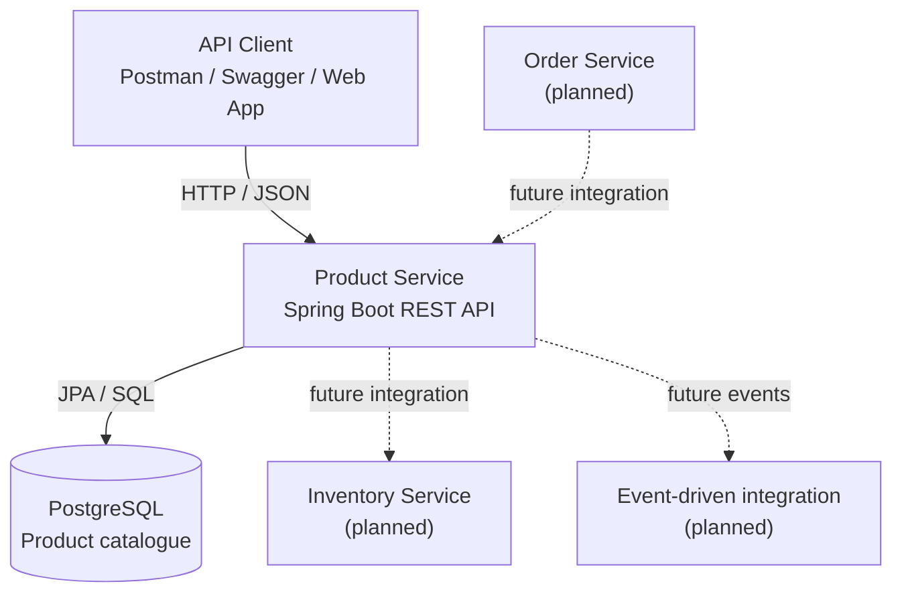
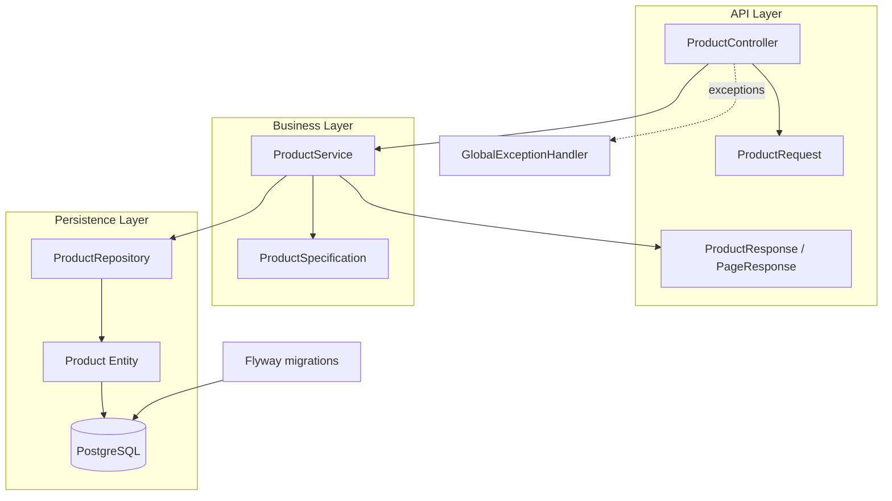
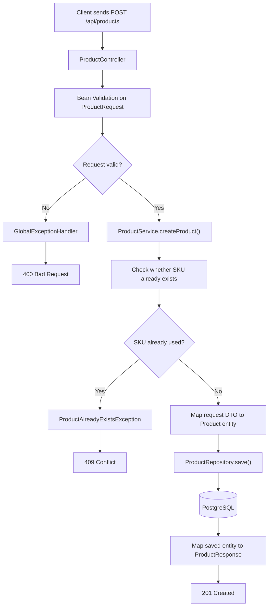
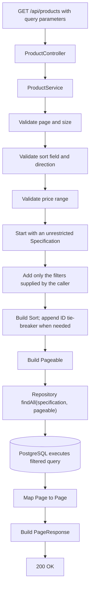
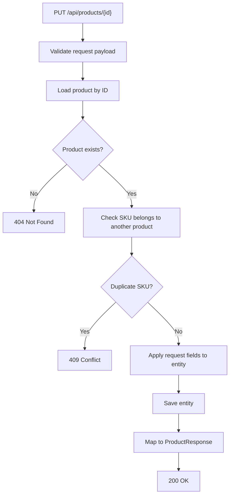
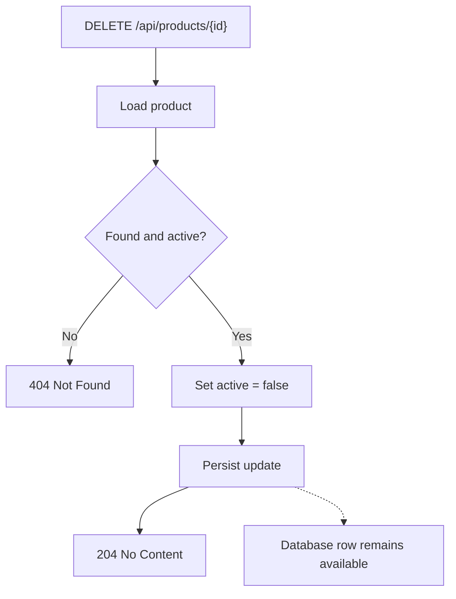
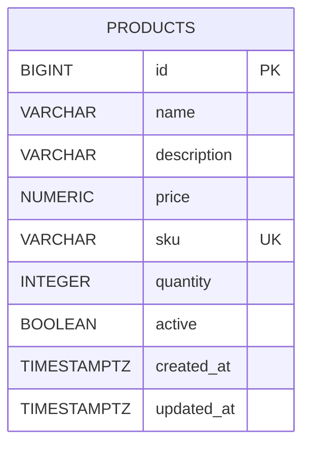

# OrderFlow – Product Service

> **Product catalogue and product lifecycle management for OrderFlow**, an evolving enterprise e-commerce microservices platform built with Java and Spring Boot.

[](https://www.oracle.com/java/)
[](https://spring.io/projects/spring-boot)
[](https://www.postgresql.org/)
[](https://maven.apache.org/)
[](#testing-strategy)

**Repository:** [github.com/anup-hbtu/OrderFlow](https://github.com/anup-hbtu/OrderFlow)  
**Module:** `product-service/`  
**Current scope:** Product CRUD, dynamic search/filtering, pagination, sorting, validation, soft deletion, centralized error responses, PostgreSQL persistence and Flyway migrations.

---

## Table of contents

- [1. What this service does](#1-what-this-service-does)
- [2. Platform context](#2-platform-context)
- [3. Architecture](#3-architecture)
- [4. Request lifecycle](#4-request-lifecycle)
- [5. Technology stack](#5-technology-stack)
- [6. Features and engineering decisions](#6-features-and-engineering-decisions)
- [7. Project structure](#7-project-structure)
- [8. Data model](#8-data-model)
- [9. API reference](#9-api-reference)
- [10. Run locally](#10-run-locally)
- [11. Database migrations](#11-database-migrations)
- [12. Testing strategy](#12-testing-strategy)
- [13. Error handling](#13-error-handling)
- [14. Design decisions and trade-offs](#14-design-decisions-and-trade-offs)
- [15. Current scope and next steps](#15-current-scope-and-next-steps)
- [16. Engineering topics demonstrated](#16-engineering-topics-demonstrated)

---

## 1. What this service does

The Product Service owns the product catalogue responsibilities in OrderFlow. It exposes REST endpoints to create, retrieve, update, search, and deactivate products.

The implementation goes beyond basic CRUD by including:

- Request validation at the API boundary.
- Unique SKU checks during create and update operations.
- Dynamic filtering using Spring Data JPA Specifications.
- Database-backed pagination and sorting.
- A maximum page-size limit and an allowlist of sortable fields.
- A stable secondary sort by product ID when another field is selected.
- Soft deletion so a product record is retained rather than physically removed.
- DTO-based request and response contracts.
- Centralized exception handling and a consistent API error DTO.
- PostgreSQL persistence with Flyway-managed schema migrations.
- Automated unit, MVC, repository, and integration-level tests.

The service is being developed as one bounded capability within a larger microservices learning project. It is not presented as a complete e-commerce platform yet.

## 2. Platform context

OrderFlow is being built incrementally. The Product Service is the first implemented business service. Other services and platform capabilities are planned separately; they should not be interpreted as already available.



**Current implementation boundary:** the solid lines represent the implemented Product Service request and persistence path. Dashed elements are future platform capabilities, not active integrations.

## 3. Architecture

The service follows a layered architecture. Each layer has a focused responsibility and communicates through explicit contracts.



### Layer responsibilities

| Component | Responsibility |
|---|---|
| `ProductController` | Maps HTTP requests to service operations and returns HTTP responses. |
| `ProductRequest` | Defines and validates the incoming product payload. |
| `ProductResponse` | Exposes product data without returning the persistence entity directly. |
| `PageResponse` | Defines a stable pagination response contract. |
| `ProductService` | Implements product use cases, validation rules, filtering composition and transaction boundaries. |
| `ProductSpecification` | Builds reusable JPA predicates for optional search filters. |
| `ProductRepository` | Uses Spring Data JPA for persistence and specification-based queries. |
| `Product` | Represents the persisted product record. |
| `GlobalExceptionHandler` | Converts known application and validation failures into structured API errors. |
| Flyway | Applies versioned database schema migrations. |

### Why keep these layers separate?

- The controller does not contain database query logic.
- The service can be tested independently from HTTP concerns.
- The repository abstracts persistence operations.
- DTOs keep the external API contract separate from the database entity.
- Specifications allow optional filters to be composed without creating a repository method for every filter combination.

## 4. Request lifecycle

### 4.1 Create product – end-to-end flow



### 4.2 Search products – filtering, sorting and pagination



### 4.3 Update product



### 4.4 Soft delete



## 5. Technology stack

| Technology | Usage |
|---|---|
| Java 25 | Application language and runtime target configured in Maven. |
| Spring Boot 4.1.2 | Application framework. |
| Spring Web MVC | REST controllers and HTTP request handling. |
| Spring Data JPA | Repository abstraction and persistence integration. |
| Hibernate / JPA | ORM and entity mapping. |
| Jakarta Bean Validation | Request payload validation. |
| PostgreSQL | Relational persistence for the running service. |
| Flyway | Versioned database schema migrations. |
| Maven Wrapper | Reproducible Maven command entry point. |
| Springdoc OpenAPI | OpenAPI specification and Swagger UI integration. |
| JUnit / Spring Boot Test / Mockito | Automated testing. |
| H2 | Lightweight in-memory database for selected tests. |
| JaCoCo | Test coverage report generation during Maven `verify`. |
| Docker Compose | Local PostgreSQL infrastructure. |

## 6. Features and engineering decisions

### 6.1 Product lifecycle operations

| Operation | Behaviour |
|---|---|
| Create | Creates a product after request validation and duplicate-SKU checking. |
| Read by ID | Retrieves one product or returns a not-found error. |
| List/search | Retrieves a page of products with optional filters and sorting. |
| Update | Updates an existing product after checking the requested SKU is not used by another product. |
| Delete | Performs a soft delete by setting `active` to `false`. |

### 6.2 Dynamic filtering with JPA Specifications

The list endpoint supports optional filters:

| Filter | Matching behaviour |
|---|---|
| `name` | Partial, case-insensitive match. |
| `sku` | Exact, case-insensitive match. |
| `minPrice` | Price greater than or equal to the supplied value. |
| `maxPrice` | Price less than or equal to the supplied value. |
| `active` | Exact active-status match. |

Filters are combined with logical **AND**. A filter is added only when the caller supplies it.

For example:

```http
GET /api/products?name=phone&minPrice=10000&maxPrice=50000&active=true
```

Conceptually, the query is:

```sql
SELECT *
FROM products
WHERE LOWER(name) LIKE '%phone%'
  AND price >= 10000
  AND price <= 50000
  AND active = TRUE;
```

The actual SQL is generated by the JPA provider from the Specification and pageable request.

**Why Specifications?** Without Specifications, supporting several optional filters can lead to many repository methods or a large number of query combinations. Specifications let the service compose predicates as needed.

### 6.3 Pagination and sorting safeguards

The service enforces:

- Page number must be zero or greater.
- Page size must be between 1 and 100.
- Sort field must be one of `id`, `name`, `price`, or `createdAt`.
- Sort direction must be `ASC` or `DESC`.
- Negative minimum or maximum prices are rejected.
- `minPrice` cannot be greater than `maxPrice`.
- When sorting by a field other than `id`, `id ASC` is appended as a tie-breaker.

The allowlist prevents callers from requesting arbitrary entity properties as sort fields. The page-size cap prevents a client from requesting an unbounded page through this endpoint.

The ID tie-breaker makes ordering deterministic when multiple rows have the same primary sort value. It does not, by itself, provide a snapshot-consistent view while records are changing between separate page requests.

### 6.4 Soft deletion

A delete request does not physically remove the product row. It changes `active` to `false`.

Benefits:
- Preserves the product record for auditability and historical reference.
- Avoids immediate loss of product data.
- Allows callers to filter active and inactive products.

The current implementation does not automatically hide inactive products from every query. Clients can explicitly use `active=true` when they only want active products.

### 6.5 DTOs and validation

The API accepts a `ProductRequest` record and returns `ProductResponse` rather than exposing the JPA entity.

Current request validation includes:
- Name is required and limited to 150 characters.
- Description is limited to 1,000 characters.
- Price is required, greater than zero, and limited to 10 integer digits and 2 fractional digits.
- SKU is required and limited to 50 characters.
- Quantity is required and cannot be negative.

Using `BigDecimal` for price avoids binary floating-point representation issues associated with `float` and `double`.

### 6.6 Transaction boundaries

`ProductService` is annotated with `@Transactional`. Read operations are explicitly marked `@Transactional(readOnly = true)`. This keeps transaction management at the business-service layer rather than scattering it across controllers.

### 6.7 Database migrations

Flyway manages schema evolution through versioned SQL migration scripts under:

`src/main/resources/db/migration/`

The application uses PostgreSQL for its local runtime database. Tests that use H2 are configured separately and should not be confused with PostgreSQL-backed integration tests.

## 7. Project structure

```text
product-service/
├── .mvn/
├── src/
│   ├── main/
│   │   ├── java/
│   │   │   └── com/orderflow/product/
│   │   │       ├── ProductServiceApplication.java
│   │   │       ├── config/
│   │   │       │   └── OpenApiConfig.java
│   │   │       ├── controller/
│   │   │       │   └── ProductController.java
│   │   │       ├── dto/
│   │   │       │   ├── ApiErrorResponse.java
│   │   │       │   ├── PageResponse.java
│   │   │       │   ├── ProductRequest.java
│   │   │       │   └── ProductResponse.java
│   │   │       ├── entity/
│   │   │       │   └── Product.java
│   │   │       ├── exception/
│   │   │       │   ├── GlobalExceptionHandler.java
│   │   │       │   ├── ProductAlreadyExistsException.java
│   │   │       │   └── ProductNotFoundException.java
│   │   │       ├── repository/
│   │   │       │   └── ProductRepository.java
│   │   │       ├── service/
│   │   │       │   └── ProductService.java
│   │   │       └── specification/
│   │   │           └── ProductSpecification.java
│   │   └── resources/
│   │       └── db/migration/
│   └── test/
│       ├── java/
│       └── resources/
├── mvnw
├── mvnw.cmd
└── pom.xml
```

## 8. Data model

The Product entity represents a catalogue item.

| Field | Type | Purpose |
|---|---|---|
| `id` | `Long` | Generated product identifier. |
| `name` | `String` | Product name; required; maximum 150 characters. |
| `description` | `String` | Optional description; maximum 1,000 characters. |
| `price` | `BigDecimal` | Product price; precision 12, scale 2. |
| `sku` | `String` | Unique stock-keeping unit; required; maximum 50 characters. |
| `quantity` | `Integer` | Non-negative quantity value stored with the product. |
| `active` | `Boolean` | Active/inactive lifecycle flag; defaults to `true`. |
| `createdAt` | `OffsetDateTime` | Creation timestamp. |
| `updatedAt` | `OffsetDateTime` | Last-update timestamp. |



The entity initializes its audit timestamps on insert and updates `updatedAt` on entity update.

**Domain boundary note:** the `quantity` field currently belongs to the Product entity. A dedicated Inventory Service with stock reservation and concurrency-safe stock updates is a planned next step. The current Product Service should not be described as implementing inventory reservation or overselling protection.

## 9. API reference

**Base path:** `/api/products`

All request and response bodies use JSON.

### Endpoint summary

| Method | Endpoint | Description | Success |
|---|---|---|---|
| `POST` | `/api/products` | Create product | `201 Created` |
| `GET` | `/api/products` | List, filter, sort and paginate products | `200 OK` |
| `GET` | `/api/products/{id}` | Retrieve product by ID | `200 OK` |
| `PUT` | `/api/products/{id}` | Update product | `200 OK` |
| `DELETE` | `/api/products/{id}` | Soft-delete product | `204 No Content` |

### 9.1 Create product

```http
POST /api/products
Content-Type: application/json
```

Request:

```json
{
  "name": "Wireless Headphones",
  "description": "Bluetooth over-ear headphones",
  "price": 2499.00,
  "sku": "AUDIO-HEADPHONE-001",
  "quantity": 25
}
```

Successful response: `201 Created`

```json
{
  "id": 1,
  "name": "Wireless Headphones",
  "description": "Bluetooth over-ear headphones",
  "price": 2499.00,
  "sku": "AUDIO-HEADPHONE-001",
  "quantity": 25,
  "active": true,
  "createdAt": "2026-01-01T10:00:00+05:30",
  "updatedAt": "2026-01-01T10:00:00+05:30"
}
```

The ID and timestamps above are illustrative response values.

Possible errors:
- `400 Bad Request` – request validation fails.
- `409 Conflict` – SKU is already in use.

### 9.2 List products

```http
GET /api/products?page=0&size=10&sortBy=price&direction=ASC
```

Supported query parameters:

| Parameter | Required | Default | Description |
|---|---:|---:|---|
| `page` | No | `0` | Zero-based page index. |
| `size` | No | `10` | Page size, from 1 to 100. |
| `sortBy` | No | `id` | `id`, `name`, `price`, or `createdAt`. |
| `direction` | No | `ASC` | `ASC` or `DESC`. |
| `name` | No | — | Partial, case-insensitive name filter. |
| `sku` | No | — | Exact, case-insensitive SKU filter. |
| `minPrice` | No | — | Inclusive lower price bound. |
| `maxPrice` | No | — | Inclusive upper price bound. |
| `active` | No | — | Filter by `true` or `false`. |

Example – combine filters:

```http
GET /api/products?page=0&size=5&sortBy=price&direction=DESC&name=phone&minPrice=10000&maxPrice=50000&active=true
```

Example response shape:

```json
{
  "content": [
    {
      "id": 2,
      "name": "Example Phone",
      "description": "Example description",
      "price": 19999.00,
      "sku": "PHONE-002",
      "quantity": 12,
      "active": true,
      "createdAt": "2026-01-01T10:00:00+05:30",
      "updatedAt": "2026-01-01T10:00:00+05:30"
    }
  ],
  "pageNumber": 0,
  "pageSize": 5,
  "totalElements": 1,
  "totalPages": 1,
  "first": true,
  "last": true,
  "hasNext": false,
  "hasPrevious": false
}
```

The values above illustrate the response structure; actual results depend on database contents.

### 9.3 Get product by ID

```http
GET /api/products/1
```

- `200 OK` when the product exists.
- `404 Not Found` when the ID does not exist.

### 9.4 Update product

```http
PUT /api/products/1
Content-Type: application/json
```

Request:

```json
{
  "name": "Wireless Headphones Pro",
  "description": "Updated Bluetooth over-ear headphones",
  "price": 2999.00,
  "sku": "AUDIO-HEADPHONE-001",
  "quantity": 30
}
```

- `200 OK` with the updated product.
- `400 Bad Request` for invalid input.
- `404 Not Found` if the product does not exist.
- `409 Conflict` if the SKU belongs to another product.

### 9.5 Soft-delete product

```http
DELETE /api/products/1
```

Successful response: `204 No Content`.

The row remains in the database and its `active` flag becomes `false`. Repeating the delete for an already inactive product returns a not-found response.

## 10. Run locally

### Prerequisites

- Git
- JDK 25
- Docker Desktop with Docker Compose
- A terminal (PowerShell examples below)

Check Java:

```powershell
java -version
```

### Step 1 – Clone the repository

```powershell
git clone https://github.com/anup-hbtu/OrderFlow.git
cd OrderFlow
```

### Step 2 – Configure local database credentials

Create the local environment file from the example:

```powershell
Copy-Item infrastructure/.env.example infrastructure/.env
```

Edit `infrastructure/.env` and set a local development password:

```env
POSTGRES_USER=orderflow
POSTGRES_PASSWORD=replace_with_a_local_password
POSTGRES_DB=orderflow
```

`infrastructure/.env` is intentionally ignored by Git. Do not commit real credentials.

### Step 3 – Start PostgreSQL

Run from the repository root:

```powershell
docker compose --env-file infrastructure/.env -f infrastructure/docker-compose.yml up -d
```

Check container health:

```powershell
docker ps
docker logs orderflow-postgres
```

The Compose configuration maps PostgreSQL host port **5433** to container port **5432**. The named volume persists database data across container restarts.

To stop the container without deleting database data:

```powershell
docker compose --env-file infrastructure/.env -f infrastructure/docker-compose.yml down
```

> Do not use `docker compose down -v` unless you intentionally want to remove the database volume and its data.

### Step 4 – Configure the Product Service database connection

The Product Service must connect to the local database using the host-side connection:

```text
Host:     localhost
Port:     5433
Database: orderflow
```

Use the same username and password configured in `infrastructure/.env`.

For a Spring Boot environment-variable configuration, the corresponding values are:

```powershell
$env:SPRING_DATASOURCE_URL = "jdbc:postgresql://localhost:5433/orderflow"
$env:SPRING_DATASOURCE_USERNAME = "orderflow"
$env:SPRING_DATASOURCE_PASSWORD = "replace_with_a_local_password"
```

If the application configuration in your checkout already defines these values or uses a different property source, retain that configuration and supply the equivalent connection settings there. Do not commit local secrets.

### Step 5 – Run the application

```powershell
cd product-service
.\mvnw.cmd spring-boot:run
```

Flyway applies the configured database migrations during application startup.

### Step 6 – Explore the API

The project includes Springdoc OpenAPI integration. When the application is running, try:

- Swagger UI: `http://localhost:8080/swagger-ui/index.html`
- OpenAPI JSON: `http://localhost:8080/v3/api-docs`

If the application uses a non-default server port or context path, use that configured value instead.

### Step 7 – Run tests

From the `product-service/` directory:

```powershell
.\mvnw.cmd test
```

Generate the JaCoCo report through Maven verify:

```powershell
.\mvnw.cmd clean verify
```

The JaCoCo HTML report is normally generated at:

```text
target/site/jacoco/index.html
```

## 11. Database migrations

Migration scripts are stored in:

```text
src/main/resources/db/migration/
```

Flyway tracks applied migrations in its schema history table. This gives the service a versioned, repeatable approach to database evolution.

Important practices:
- Add a new versioned migration for a schema change.
- Do not edit a migration that has already been applied to a shared or persistent database.
- Test migrations against the target database engine.
- Keep migration history and application entity mappings consistent.

The test profile uses H2 for selected automated tests and disables Flyway there. Therefore, an H2 test passing is not proof that every PostgreSQL-specific migration has been exercised by that test.

## 12. Testing strategy

The Product Service has a layered automated test suite. The last verified run completed with **79 tests, 0 failures, 0 errors and 0 skipped**.

| Test area | What it verifies |
|---|---|
| Service unit tests | Business rules, validation, mapping and repository interactions. |
| Controller tests | HTTP routes, status codes, request handling and response contracts. |
| Repository tests | Spring Data repository behaviour. |
| Specification unit tests | Predicate construction and filter behaviour. |
| Specification integration tests | Filter behaviour against an H2-backed JPA context. |
| Service integration tests | Combined filtering, pagination and sorting through the persistence layer. |
| Application test | Spring application context startup. |

### Test database note

The automated test configuration uses an in-memory H2 database in PostgreSQL compatibility mode for selected tests. It is **not** a Testcontainers-based PostgreSQL test suite. The application runtime uses PostgreSQL.

### Run the suite

```powershell
.\mvnw.cmd test
```

A successful Maven run should finish with:

```text
BUILD SUCCESS
```

The exact test count may change as the service evolves.

## 13. Error handling

Known application errors are handled centrally through `GlobalExceptionHandler` and represented using `ApiErrorResponse`.

| Scenario | HTTP status |
|---|---:|
| Invalid request body or invalid query parameters | `400 Bad Request` |
| Product does not exist | `404 Not Found` |
| SKU already exists or belongs to another product | `409 Conflict` |
| Successful create | `201 Created` |
| Successful read or update | `200 OK` |
| Successful soft delete | `204 No Content` |

This keeps error translation out of individual controller methods and provides a consistent contract for API clients.

## 14. Design decisions and trade-offs

| Decision | Why it was chosen | Trade-off / limitation |
|---|---|---|
| Layered architecture | Keeps HTTP, business and persistence responsibilities separate. | Requires clear boundaries and mapping between layers. |
| DTOs | Protects the API contract from direct entity exposure. | Requires explicit mapping code. |
| JPA Specifications | Supports composable optional filters. | Complex search requirements may eventually need dedicated query approaches. |
| Pagination cap | Limits the amount of data requested in one call. | Clients must navigate multiple pages for large result sets. |
| Sort-field allowlist | Prevents arbitrary property sorting and makes the API contract explicit. | New sortable fields must be deliberately added. |
| ID tie-breaker | Makes ordering deterministic for equal primary sort values. | Does not guarantee a snapshot across multiple page requests while data changes. |
| Soft delete | Retains product records. | Queries must deliberately decide whether inactive products should be included. |
| `BigDecimal` for price | Appropriate decimal representation for monetary values. | Requires deliberate precision and scale rules. |
| Flyway migrations | Makes schema evolution explicit and versioned. | Applied migrations should be treated as immutable. |
| H2 test database | Fast feedback for many persistence tests. | PostgreSQL-specific behaviour still needs PostgreSQL verification. |

## 15. Current scope and next steps

### Implemented in this module

- [x] Product create, read, update and soft delete.
- [x] Request validation.
- [x] Duplicate SKU checks.
- [x] Dynamic filtering with JPA Specifications.
- [x] Pagination and sorting.
- [x] Page-size and sort-field safeguards.
- [x] Stable ID tie-breaker for sorting.
- [x] DTO-based API contracts.
- [x] Centralized exception handling.
- [x] PostgreSQL runtime persistence.
- [x] Flyway migration support.
- [x] OpenAPI / Swagger documentation.
- [x] Automated tests (last verified: 79 passing).

### Not yet implemented / planned at platform level

- [ ] Dedicated Inventory Service with atomic stock updates and overselling protection.
- [ ] Order Service and order lifecycle.
- [ ] Inter-service communication and event-driven workflows.
- [ ] Authentication and authorization.
- [ ] API gateway and service discovery.
- [ ] Distributed tracing, centralized logging and metrics.
- [ ] Containerization of each application service and deployment automation.
- [ ] PostgreSQL-backed integration tests using a disposable database environment.

These are roadmap items, not claims about the current Product Service.

## 16. Engineering topics demonstrated

This module provides practical examples of:

- REST API design and HTTP semantics.
- Spring Boot application layering.
- Constructor-based dependency injection.
- Service-level transaction management.
- Spring Data JPA repositories.
- Entity lifecycle callbacks and audit timestamps.
- DTOs and Java records.
- Jakarta Bean Validation.
- Dynamic query construction with JPA Criteria / Specifications.
- Pagination and deterministic sorting.
- Database constraints and uniqueness checks.
- Soft-delete lifecycle modelling.
- Centralized exception handling.
- Flyway schema versioning.
- Unit, MVC, repository and integration testing.
- Local infrastructure management with Docker Compose.

---

## Project status

**Product Service is the first implemented business capability in OrderFlow.** It currently provides a tested product catalogue API backed by PostgreSQL. The wider platform is being developed incrementally, with inventory and order workflows planned as separate services.

If you are reviewing this repository, the Product Service source code is under [`product-service/src`](./src), and the platform-level infrastructure configuration is in [`../infrastructure`](../infrastructure).

---

*Built as an evolving backend engineering project to explore practical service design, persistence, API contracts, testing and production-oriented trade-offs.*
